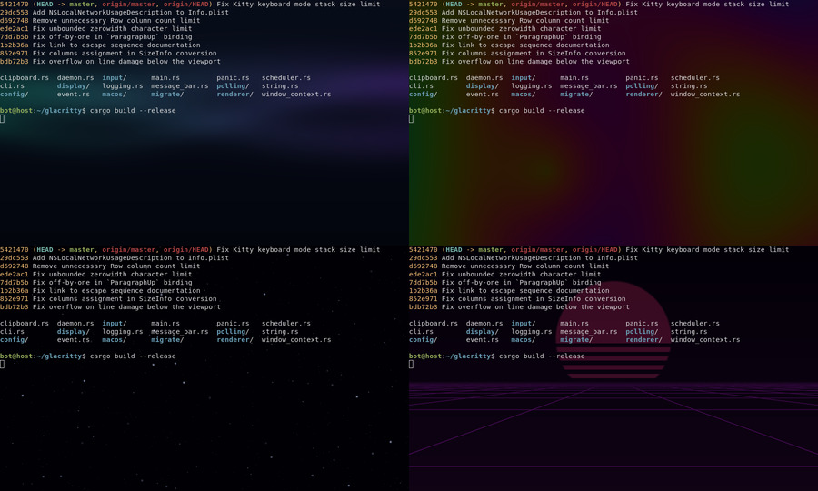
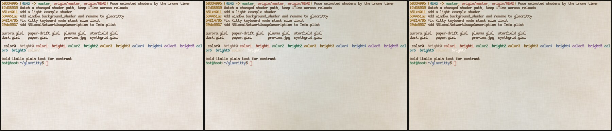

# Glacritty

Alacritty with a GPU shader as its background. The binary is `glacritty` and it
reads `~/.config/glacritty/glacritty.toml`, so it installs beside Alacritty
without either reading the other's config.



```toml
[window]
background_shader = "~/.config/glacritty/aurora.glsl"
```

The shader is a Shadertoy-style GLSL fragment shader drawn across the whole
window behind the cells:

```glsl
void mainImage(out vec4 fragColor, in vec2 fragCoord) {
    vec2 uv = fragCoord / iResolution.xy;
    fragColor = vec4(0.1 * uv, 0.15 + 0.05 * sin(iTime), 1.0);
}
```

- `iResolution` (`vec3`): window size in pixels.
- `iTime` (`float`): seconds since the shader loaded.
- The output alpha is ignored; `window.opacity` applies as usual. Text, cursor,
  selection and cells with a non-default background draw on top as before.
- A shader that reads `iTime` redraws every frame; one that does not redraws
  only when the terminal changes, like stock Alacritty.
- Relative paths resolve against the main config file's directory. Saving the
  shader reloads it in every open window, as long as a config file is in use; a
  compile error shows in the message bar and the last good shader keeps running.
  Reloading keeps `iTime` running.

Examples live in [extra/shaders](extra/shaders): `aurora`, `plasma`, `starfield`
and `synthgrid` animate on dark color schemes; `dusk` is still. `paper` is a
still linen-paper texture for a warm light scheme (background `#E8E1D9`), and
`paper-drift` is the same texture with ochre and teal washes drifting across it.



Rebasing on upstream is described in [AGENTS.md](AGENTS.md).

---

<p align="center">
    
</p>

<h1 align="center">Alacritty - A fast, cross-platform, OpenGL terminal emulator</h1>

<p align="center">
  
</p>

## About

Alacritty is a modern terminal emulator that comes with sensible defaults, but
allows for extensive [configuration](#configuration). By integrating with other
applications, rather than reimplementing their functionality, it manages to
provide a flexible set of [features](./docs/features.md) with high performance.
The supported platforms currently consist of BSD, Linux, macOS and Windows.

The software is considered to be at a **beta** level of readiness; there are
a few missing features and bugs to be fixed, but it is already used by many as
a daily driver.

Precompiled binaries are available from the [GitHub releases page](https://github.com/alacritty/alacritty/releases).

Join [`#alacritty`] on libera.chat if you have questions or looking for a quick help.

[`#alacritty`]: https://web.libera.chat/gamja/?channels=#alacritty

## Features

You can find an overview over the features available in Alacritty [here](./docs/features.md).

## Further information

- [Announcing Alacritty, a GPU-Accelerated Terminal Emulator](https://jwilm.io/blog/announcing-alacritty/) January 6, 2017
- [A talk about Alacritty at the Rust Meetup January 2017](https://www.youtube.com/watch?v=qHOdYO3WUTk) January 19, 2017
- [Alacritty Lands Scrollback, Publishes Benchmarks](https://jwilm.io/blog/alacritty-lands-scrollback/) September 17, 2018

## Installation

Alacritty can be installed by using various package managers on Linux, BSD,
macOS and Windows.

Prebuilt binaries for macOS and Windows can also be downloaded from the
[GitHub releases page](https://github.com/alacritty/alacritty/releases).

For everyone else, the detailed instructions to install Alacritty can be found
[here](INSTALL.md).

### Requirements

- At least OpenGL ES 2.0
- [Windows] ConPTY support (Windows 10 version 1809 or higher)

## Configuration

You can find the documentation for Alacritty's configuration in `man 5
alacritty`, or by looking at [the website] if you do not have the manpages
installed.

[the website]: https://alacritty.org/config-alacritty.html

Alacritty doesn't create the config file for you, but it looks for one in the
following locations:

1. `$XDG_CONFIG_HOME/alacritty/alacritty.toml`
2. `$XDG_CONFIG_HOME/alacritty.toml`
3. `$HOME/.config/alacritty/alacritty.toml`
4. `$HOME/.alacritty.toml`
5. `/etc/alacritty/alacritty.toml`

On Windows, the config file will be looked for in:

* `%APPDATA%\alacritty\alacritty.toml`

## Contributing

A guideline about contributing to Alacritty can be found in the
[`CONTRIBUTING.md`](CONTRIBUTING.md) file.

## FAQ

**_Is it really the fastest terminal emulator?_**

Benchmarking terminal emulators is complicated. Alacritty uses
[vtebench](https://github.com/alacritty/vtebench) to quantify terminal emulator
throughput and manages to consistently score better than the competition using
it. If you have found an example where this is not the case, please report a
bug.

Other aspects like latency or framerate and frame consistency are more difficult
to quantify. Some terminal emulators also intentionally slow down to save
resources, which might be preferred by some users.

If you have doubts about Alacritty's performance or usability, the best way to
quantify terminal emulators is always to test them with **your** specific
usecases.

**_Why isn't feature X implemented?_**

Alacritty has many great features, but not every feature from every other
terminal. This could be for a number of reasons, but sometimes it's just not a
good fit for Alacritty. This means you won't find things like tabs or splits
(which are best left to a window manager or [terminal multiplexer][tmux]) nor
niceties like a GUI config editor.

[tmux]: https://github.com/tmux/tmux

## License

Alacritty is released under the [Apache License, Version 2.0].

[Apache License, Version 2.0]: https://github.com/alacritty/alacritty/blob/master/LICENSE-APACHE
